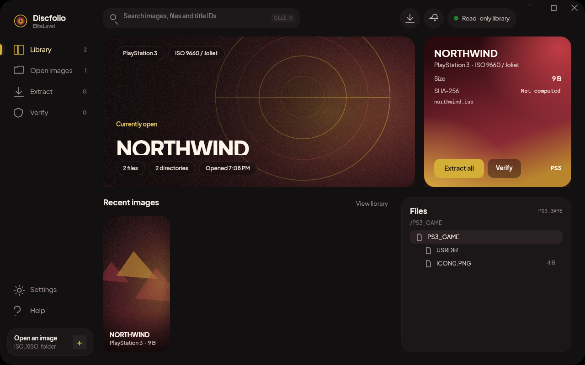

<div align="center">


# EliteLevel Discfolio

by Elite Level Software

[](LICENSE)
[](https://dotnet.microsoft.com/)
[](#download)

A read-only explorer for console disc images and folder dumps.

[Download](#download)



</div>

## Download

Windows portable build (single file, `win-x64`):

The installer and portable archive are published with a release. Until then, build from source with the profile in `src/EliteLevel.Disc.App/Properties/PublishProfiles`.

SHA-256: `0000000000000000000000000000000000000000000000000000000000000000`

Replace that digest with the hash from `SHA256SUMS.txt` when a release is published.

## Browse

Open an ISO 9660 or Joliet image, an Xbox or Xbox 360 XDVDFS image (plain, XGD1, XGD2, XGD3, or a Redump layout with a video partition in front), or a folder dump. Detection uses the contents of the file, not the extension.

The window shows the volume, the file tree, and recent images on this machine. Drag an image onto the window to open it.

## Extract

Copy the selection or the whole image to a folder you choose. Skip-existing treats a destination file of the same size as success, so extracting again into the same folder is safe. The source image is opened read-only and is never rewritten.

`EBOOT.BIN`, `PS3_UPDATE`, `LICDIR`, and `$SystemUpdate` are skipped unless you explicitly include protected paths. That copy is still the original bytes.

## Verify

SHA-256 is one click, or `discfolio hash`. SHA-1 and MD5 are available because some archival lists still publish them. A manifest can be saved as text. Click a hash to copy it.

## Command line

`discfolio` is the same core library, without the user interface.

```text
discfolio info game.iso
discfolio list game.iso --path /PS3_GAME/USRDIR --long
discfolio extract game.iso --out ./out --pattern "*.png" --skip-existing
discfolio hash game.iso --manifest game.sha256
discfolio search game.iso ICON0
```

`--json` is stable output for scripts. See [docs/user-guide.md](docs/user-guide.md).

## Build

```text
dotnet test
dotnet run --project src/EliteLevel.Disc.App
dotnet run --project src/EliteLevel.Disc.Cli -- info path/to/image.iso
```

The Windows portable profile:

```text
dotnet publish src/EliteLevel.Disc.App -c Release /p:PublishProfile=win-x64-portable
```

## Legal

Discfolio is for dumps and folders you are allowed to possess. It does not include encryption keys or game content, and it does not modify the source. PlayStation, Xbox, and Nintendo are trademarks of their owners. Elite Level Software is not affiliated with them.

The stance is in [LEGAL.md](LEGAL.md). Third-party licenses are in [THIRD_PARTY_NOTICES](THIRD_PARTY_NOTICES). This project is [MIT](LICENSE) licensed, copyright Elite Level Software.
